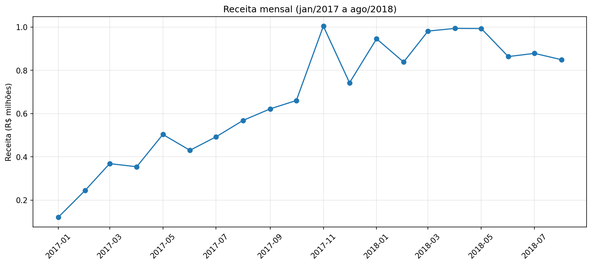
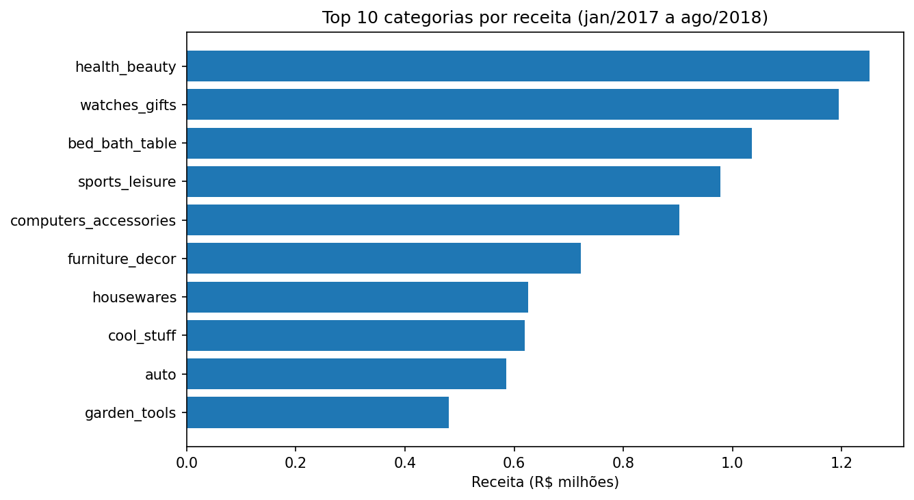

README ENGLISH VERSION

# Olist Sales Performance Analysis

[Português](README.pt-BR.md)

SQL and Python analysis of a Brazilian e-commerce marketplace: revenue trend, product categories, regional performance and the link between delivery delays and customer satisfaction.

## Business questions

1. How did monthly revenue evolve?
2. Which product categories concentrate revenue?
3. Which states drive sales, and how do delivery times and delays vary by state?
4. Are late deliveries associated with lower customer ratings?

## Data and tools

- **Data:** [Brazilian E-Commerce Public Dataset by Olist](https://www.kaggle.com/datasets/olistbr/brazilian-ecommerce) (Kaggle), 9 related tables covering orders, items, customers, products, payments and reviews. The CSV files are not included in this repository.
- **Tools:** SQL (DuckDB), Python (pandas, matplotlib), Google Colab.

## Assumptions

1. Revenue = sum of `price` in `order_items` (freight excluded).
2. Orders with status `canceled` or `unavailable` are excluded.
3. Analysis window: Jan/2017 to Aug/2018 (20 full months). Sep/2016 to Dec/2016 and Sep/2018 have residual volume.
4. Reviews: one per order (the most recent), since 555 orders have more than one review.
5. Categories translated to English with the translation table; untranslated products keep the original name and products without a category are labeled `sem_categoria`.
6. State = the customer's state.
7. Delivery analysis uses only `delivered` orders with a delivery date; states with fewer than 100 orders are excluded.

## Key findings

**Revenue**
- Monthly revenue grew from R$ 120 thousand (Jan/2017) to a peak of R$ 1.0 million in Nov/2017.
- From Mar to Aug/2018 it stayed between about R$ 850 thousand and R$ 994 thousand, without a clear upward trend. Year-over-year growth slowed from +687% in Jan/2018 to +49% in Aug/2018 (part of this is a low 2017 base).
- Average order value stayed roughly between R$ 125 and R$ 153, so growth came from order volume, not from higher prices.
- Black Friday (Nov 24, 2017) had 1,166 orders, more than double the second-best day of the month (498).

**Categories**
- No single category exceeds 10% of revenue; the largest is `health_beauty` (9.3%).
- The top 7 categories account for 49.9% of revenue and the top 15 for 76.3%.
- Volume and value differ: `bed_bath_table` has the most orders but ranks third in revenue, while `watches_gifts` has about 40% fewer orders than `health_beauty` and similar revenue, thanks to a higher revenue per order.

**Regions and delivery**
- São Paulo (SP) accounts for 38.3% of revenue; SP, RJ and MG together account for 63.4%.
- Average delivery time ranges from 8.7 days (SP) to 26.4 days (AM).
- Long delivery time does not always mean more delays: AM takes 26.4 days on average but only 4.1% of orders arrive after the estimated date, while AL has the highest late rate (24.0%).
- RJ, the second-largest market, has 13.5% of orders delivered late, against 5.9% in SP.

**Customer satisfaction**
- Late orders (8.1% of delivered orders with a review) have an average rating of 2.55, against 4.28 for on-time orders. This is an association, not proof of causation.

## Recommendations (hypotheses to validate)

1. Review delivery promises in AL and RJ, where delays stand out.
2. Plan inventory and logistics for demand peaks such as Black Friday.
3. Investigate the 2018 slowdown before assuming continued growth.
4. Reduce the dependence on SP with actions in other states.

## Limitations

- Revenue excludes freight.
- Sellers were not analyzed.
- Delays are measured against the delivery date estimated by the platform itself.
- The dataset covers 2016 to 2018 and may not reflect current behavior.

## Repository structure

- `sql/`: queries organized by topic
- `notebooks/`: analysis notebook (SQL + Python)
- `images/`: charts used in this README

## How to reproduce

1. Download the dataset from Kaggle.
2. Upload the 9 CSV files to a folder named `olist` in your Google Drive.
3. Open the notebook in Colab (button above) and run all cells.

