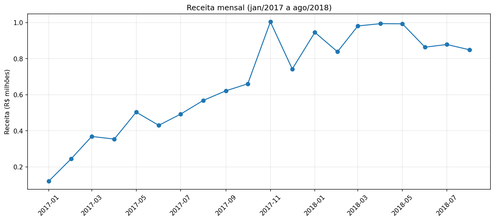
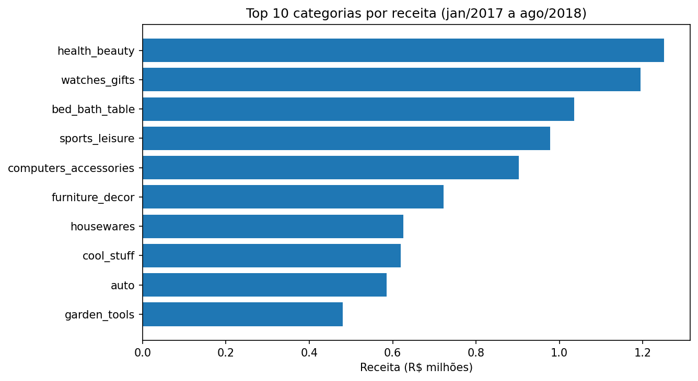

# Análise de Desempenho de Vendas da Olist

[English](README.md)

Análise em SQL e Python de um marketplace brasileiro de e-commerce: evolução da receita, categorias de produto, desempenho regional e relação entre atrasos na entrega e satisfação do cliente.

## Perguntas de negócio

1. Como evoluiu a receita mensal?
2. Quais categorias de produto concentram a receita?
3. Quais estados lideram as vendas e como variam prazo de entrega e atrasos por estado?
4. Entregas atrasadas estão associadas a notas menores dos clientes?

## Dados e ferramentas

- **Dados:** [Brazilian E-Commerce Public Dataset by Olist](https://www.kaggle.com/datasets/olistbr/brazilian-ecommerce) (Kaggle), 9 tabelas relacionadas com pedidos, itens, clientes, produtos, pagamentos e avaliações. Os arquivos CSV não estão neste repositório.
- **Ferramentas:** SQL (DuckDB), Python (pandas, matplotlib), Google Colab.

## Premissas

1. Receita = soma de `price` em `order_items` (sem frete).
2. Pedidos com status `canceled` ou `unavailable` foram excluídos.
3. Janela de análise: jan/2017 a ago/2018 (20 meses completos). Set a dez/2016 e set/2018 têm volume residual.
4. Avaliações: uma por pedido (a mais recente), pois 555 pedidos têm mais de uma avaliação.
5. Categorias traduzidas para inglês pela tabela de tradução; produtos sem tradução mantêm o nome original e produtos sem categoria aparecem como `sem_categoria`.
6. Estado = estado do cliente.
7. A análise de entrega usa só pedidos `delivered` com data de entrega; estados com menos de 100 pedidos foram excluídos.

## Principais achados

**Receita**
- A receita mensal cresceu de R$ 120 mil (jan/2017) até um pico de R$ 1,0 milhão em nov/2017.
- De mar a ago/2018 ficou entre cerca de R$ 850 mil e R$ 994 mil, sem tendência clara de alta. A variação anual desacelerou de +687% em jan/2018 para +49% em ago/2018 (parte disso é efeito de uma base baixa em 2017).
- O ticket médio ficou entre cerca de R$ 125 e R$ 153, então o crescimento veio do volume de pedidos, não de preços maiores.
- A Black Friday (24/11/2017) teve 1.166 pedidos, mais que o dobro do segundo melhor dia do mês (498).

**Categorias**
- Nenhuma categoria passa de 10% da receita; a maior é `health_beauty` (9,3%).
- As 7 maiores categorias somam 49,9% da receita e as 15 maiores, 76,3%.
- Volume e valor diferem: `bed_bath_table` tem mais pedidos, mas é a 3ª em receita, enquanto `watches_gifts` tem cerca de 40% menos pedidos que `health_beauty` e receita parecida, por causa da maior receita por pedido.

**Regiões e entrega**
- São Paulo (SP) responde por 38,3% da receita; SP, RJ e MG juntos, por 63,4%.
- O prazo médio de entrega vai de 8,7 dias (SP) a 26,4 dias (AM).
- Prazo longo não significa mais atrasos: AM leva 26,4 dias em média, mas só 4,1% dos pedidos chegam após a data estimada, enquanto AL tem o maior índice de atrasos (24,0%).
- O RJ, segundo maior mercado, tem 13,5% dos pedidos entregues com atraso, contra 5,9% em SP.

**Satisfação do cliente**
- Pedidos atrasados (8,1% dos pedidos entregues com avaliação) têm nota média de 2,55, contra 4,28 dos entregues no prazo. É uma associação, não prova de causa.

## Recomendações (hipóteses a validar)

1. Rever a promessa de prazo em AL e RJ, onde os atrasos se destacam.
2. Planejar estoque e logística para picos de demanda como a Black Friday.
3. Investigar a desaceleração de 2018 antes de assumir crescimento contínuo.
4. Reduzir a dependência de SP com ações em outros estados.

## Limitações

- A receita não inclui frete.
- Vendedores não foram analisados.
- Os atrasos são medidos contra a data estimada pela própria plataforma.
- Os dados cobrem 2016 a 2018 e podem não refletir o comportamento atual.

## Estrutura do repositório

- `sql/`: queries organizadas por tema
- `notebooks/`: notebook da análise (SQL + Python)
- `images/`: gráficos usados neste README

## Como reproduzir

1. Baixe o dataset no Kaggle.
2. Envie os 9 arquivos CSV para uma pasta chamada `olist` no seu Google Drive.
3. Abra o notebook no Colab (botão acima) e execute todas as células.

